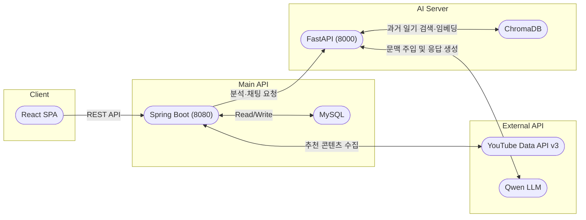

# 🌼 Freesia (프리지아) : 내 마음을 알아주는 AI 감정 일기장

> "당신의 하루에 피어나는 따뜻한 위로"
> AI 기반 감정 분석, 공감형 챗봇, 감정 기반 음악·활동 추천을 결합한 감정 일기 웹 서비스

<br/>

## 💡 프로젝트 소개

일기를 쓰며 하루를 돌아볼 때, 따뜻한 색감과 AI의 피드백으로 심리적 안정감을 주는 서비스입니다.
일기의 감정을 분석해 위로 메시지를 주고, 과거 일기를 검색해 대화에 활용하는 챗봇(RAG)과 감정에 어울리는 음악·활동 추천 기능을 제공합니다.

## 👥 개발 정보

- **기간:** 2025.09 ~ 2026.07 (캡스톤디자인에서 시작해 KT·㈜생각을코딩하다 PBL 과정에서 고도화)
- **팀:** 3인 (팀장: 이제민)
- **담당 역할 (팀장)**
  - 백엔드: Spring Boot 기반 REST API 서버 설계·구현 (회원·JWT 인증, 일기·감정, 추천 도메인)
  - DB: MySQL 모델링 (ERD 설계)
  - AI 서버: FastAPI 엔드포인트, ChromaDB 기반 RAG 검색, 감정 분류 모델 학습(MLflow)
  - 외부 API 연동: YouTube Data API 콘텐츠 수집 및 추천 스케줄러
  - 프론트엔드: 팀원과 분담하여 주요 기능 개발·통합
- **개발 방식:** LLM 코딩 도구와 검색을 활용해 개발했으며, 설계 판단과 원인 분석은 직접 수행했습니다.

<br/>

## 📸 서비스 화면 (Preview)

<p align="center">
  
  
  
</p>

<br/>

## 🛠 기술 스택 (Tech Stack)

### Frontend

- **Framework:** React, TypeScript, Vite
- **Styling:** Tailwind CSS
- **State & Routing:** Zustand, React Router

### Backend (Main API)

- **Framework:** Java 17, Spring Boot 3.x, Spring Data JPA
- **Database:** MySQL
- **Auth:** JWT, Spring Security

### AI Server & Data Pipeline

- **Framework:** Python, FastAPI, Uvicorn
- **Vector DB:** ChromaDB (RAG 검색용 일기 저장소)
- **Model:** Qwen/Qwen3.5-35B-A3B-FP8 (LLM API), KR-SBERT (임베딩)
- **ML/Data:** scikit-learn (TF-IDF + 로지스틱 회귀 감정 분류), MLflow, PySpark/Pandas (말뭉치 전처리)

### Infra

- Docker, Docker Compose, Nginx (현재 로컬 실행 기준, 외부 배포는 하지 않았습니다)

<br/>

## 🏗 시스템 아키텍처

```text
Client (React)
  ↔ Main API Server (Spring Boot, 8080)
  ↔ AI Server (FastAPI, 8000)
      ↳ [RAG] ↔ Vector DB (ChromaDB)
  ↔ External API (Qwen LLM / YouTube Data API v3)
```

```text
FREESIA-FINAL/
├── frontend/   (React SPA, Dockerfile, nginx.conf)
├── backend/    (Spring Boot REST API)
│   └── src/main/java/com/freesia/backend
│       ├── analysis/       # AI 서버 통신
│       ├── chat/           # 채팅
│       ├── diary/          # 일기 및 감정 처리
│       ├── member/         # 회원 및 JWT 인증
│       └── recommendation/ # 콘텐츠 수집·추천 스케줄러
└── ai-server/  (FastAPI & ML Pipeline)
    ├── etl/            # 말뭉치 데이터 전처리 (PySpark)
    ├── training/       # 감정 분류 모델 학습 (MLflow)
    ├── app.py          # FastAPI 엔드포인트 (/api/analyze, /api/chat)
    └── rag_service.py  # ChromaDB 벡터 검색
```



### ERD


MySQL Workbench로 설계한 데이터베이스 ERD입니다.

<br/>

## ✨ 핵심 기능

1. **감정 분석 일기:** 일기 내용을 분석해 감정과 위로 메시지를 제공합니다.
2. **RAG 기반 공감 챗봇:** 채팅 중 사용자의 과거 일기를 검색해 시스템 프롬프트에 넣어, 지난 기록을 바탕으로 대화합니다.
3. **감정 달력:** 날짜별 감정을 달력에 표시하고, 일기 상세를 모달로 확인합니다.
4. **감정 기반 콘텐츠 추천:** YouTube 등에서 수집해 저장한 콘텐츠를 감정에 맞춰 추천하고, '싫어요'를 누른 콘텐츠는 이후 추천에서 제외합니다.

<br/>

## 🔥 트러블슈팅

각 항목은 문제 → 원인 → 조치 → 배운 점 순서로 정리했습니다.

### 1. [Backend] 새벽 시간대 일기 날짜가 하루 전으로 저장되는 문제 (KST/UTC)

- **문제:** 한국 시간 00:00~09:00에 일기를 쓰면 DB에 전날 날짜로 저장됨.
- **원인 분석:** 브라우저가 보내는 날짜(UTC 변환)와 서버 JVM 기본 타임존이 한국 시간과 어긋남.
- **시도했으나 부족했던 방법:** 프론트에서 KST 오프셋을 계산해 전송(상태 관리 시점 때문에 불안정), `@PostConstruct`로 타임존 설정(Hibernate 초기화가 더 빨라 적용 안 됨), `@PrePersist`에서 `date == null`일 때만 주입(프론트가 잘못된 날짜를 보내면 무시됨).
- **조치:** 클라이언트가 보낸 날짜를 신뢰하지 않고 서버가 날짜를 정하도록 변경. 앱 시작 시 JVM 타임존을 `Asia/Seoul`로 설정, `Diary` 엔티티의 `@PrePersist`에서 `LocalDate.now(ZoneId.of("Asia/Seoul"))`로 덮어쓰기, JSON 직렬화 시간대도 `Asia/Seoul`로 통일.
- **배운 점:** 비즈니스상 중요한 날짜는 클라이언트 환경에 맡기지 않고 서버에서 일관되게 관리해야 합니다.

```java
// backend/.../diary/entity/Diary.java 일부
@PrePersist
public void prePersist() {
    this.date = LocalDate.now(ZoneId.of("Asia/Seoul"));
}
```

### 2. [AI/RAG] 모호한 질문에서 맥락에 맞지 않는 과거 일기가 검색되는 문제

- **문제:** "오늘 하루 어땠어?" 같은 질문은 의미 유사도만으로 검색하면 현재 대화와 무관한 과거 일기가 선택됨.
- **조치:** 질문에서 "오늘", "어제" 같은 날짜 표현을 찾아 ChromaDB의 `date` 메타데이터 필터로 사용하고, 검색된 결과를 최신 날짜순으로 정렬해 컨텍스트로 전달.
- **한계:** 유사도로 상위 k개를 뽑은 뒤 표시 순서를 정렬하는 방식이라, "최신 일기를 우선 검색"하는 것은 아닙니다. 정확도 개선 수치는 측정하지 않았습니다.

```python
# ai-server/rag_service.py 일부
target_date = _extract_date_filter(query_text)
where_clause = {"date": target_date} if target_date else None
# ... 벡터 검색 수행 ...
similar_diaries.sort(key=lambda x: x["date"], reverse=True)
```

### 3. [Backend] 외부 API 할당량 제약과 추천 개인화

- **문제:** YouTube Data API는 일일 무료 할당량이 있어, 수집 테스트를 반복하다 `403 Quota Exceeded`가 발생.
- **조치:** 수집 스케줄러를 분리해 음악 수집을 주 1회(월요일 새벽)로 설정하고, 검색 요청에 음악 카테고리(`videoCategoryId=10`)를 지정. 검색어의 제외 키워드가 정상 결과까지 걸러내는 문제가 있어 요청 조건을 단순화.
- **개인화:** 사용자의 '싫어요'를 `RecommendationFeedback` 엔티티로 저장하고, 추천 API에서 해당 콘텐츠를 제외한 뒤 카테고리별로 추천.
- **참고:** 노출 반복을 줄이기 위한 셔플은 추천 단계에서 적용했으며, 난수 생성 방식은 개선할 부분이 있어 정리 예정입니다.

### 4. [Backend] 달력 조회 API 500 에러 (JPA DTO 조회)

- **문제:** 감정 달력 조회 API가 DTO 인스턴스화 실패로 500 에러를 반환.
- **원인 분석:** JPA가 쿼리 결과를 DTO로 바로 받을 때 사용하는 생성자의 파라미터 타입·순서(`Long`, `LocalDateTime`, `String`)가 DTO 정의와 맞지 않았고, 날짜는 프론트가 기대하는 `yyyy-MM-dd` 형식과 달랐음.
- **조치:** DTO를 조회 결과와 맞는 생성자를 가진 클래스로 수정하고, `@JsonFormat`으로 날짜를 `yyyy-MM-dd` 문자열로 직렬화.
- **배운 점:** JPA DTO 조회는 조회 결과의 타입·순서와 DTO 생성자가 일치해야 하고, 응답 형식은 프론트와 먼저 맞춰야 합니다.

<br/>

## 🚀 시작하기

로컬에서 실행하는 방법입니다. 현재 프로젝트는 외부에 배포되어 있지 않습니다.

```bash
# 1. 클론
git clone https://github.com/wpals0713/freesia-capstone.git
cd freesia-capstone

# 2. 환경 변수 파일 준비 (저장소에는 포함되어 있지 않습니다)
# 루트에 .env 를 만들고 docker-compose.yml 이 참조하는 값을 입력
#   DB_PASSWORD, YOUTUBE_API_KEY, DCU_LLM_API_KEY, OPENAI_API_KEY
# 로컬에 MySQL 이 실행 중이어야 하며, freesia 데이터베이스가 필요합니다.

# 3. 전체 서버 빌드 및 실행
docker compose up --build -d
# frontend: http://localhost:3000 / backend: 8080 / ai-server: 8000
```

<br/>

## 🧭 한계 및 향후 계획

- **인프라:** 현재 Docker Compose 기반 로컬 실행입니다. GitHub Actions와 클라우드 배포 자동화는 계획 단계입니다.
- **AI:** 감정 분류는 TF-IDF + 로지스틱 회귀 기반이며, 다중 감정(multi-label) 분석과 모델 고도화를 검토 중입니다.
- **UX:** 월간·연간 감정 통계 리포트 화면을 추가할 계획입니다.
- **코드 정리:** 추천 셔플의 난수 생성 방식, 설정 파일의 비밀값 분리를 개선할 예정입니다.
